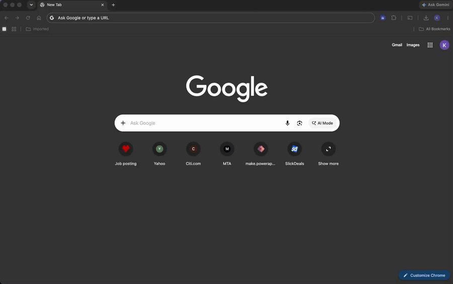

# Job Posting Analyzer

> A Chrome extension that turns any job listing into a structured, scored breakdown — allowing the user to analyze and manage job listings, rank them against your profile (resume/considerations) to help them find the right job.



Job Posting Analyzer is a **WXT (Manifest V3) + React 18 + TypeScript** side-panel extension backed by an **Azure Functions** API that calls **Azure OpenAI** with strict JSON-schema outputs. Click the toolbar icon on a job listing and the side panel shows work arrangement (remote/hybrid/onsite) with evidence and confidence, salary, seniority, and tech stack — plus a 0–100 fit score against your candidate profile.

**[Install from the Chrome Web Store](https://chromewebstore.google.com/detail/kbdecogbebgmeefjkppickfgegbheipc)** — free to start: sign in with any Google account and get 50 analyses per month plus a 100-posting library. A **Premium** subscription ($5/month, billed by Paddle) raises that to 300 analyses, a 1,000-posting library, and a higher-quality model. Profiles and saved postings live server-side per account, so they follow you across devices and browsers.

A companion **web app** (hosted on Azure Static Web Apps) signs in with the same Google account and reads/writes the same server-side profile and library — plus lets you analyze a job posting from an uploaded `.docx`/`.pdf` instead of a browser tab.

---

## What it does

| Surface | Capability |
|---|---|
| **Analyze** | One click extracts work arrangement, salary, seniority, and tech stack from any job page — with evidence quotes and confidence levels |
| **Fit score** | 0–100 match against your candidate profile, shown with a verdict (Strong match, Worth a shot, Stretch, Long shot, Dealbreaker), the quotes behind each matched or missing requirement, and a breakdown of gaps and strengths/weaknesses. Violated dealbreakers are listed beside the score and never lower it. Scores marked **out of date** were made against an older profile; **Rescore** updates them. Confirm a missing skill with "I have this" |
| **Candidate profile** | Paste your résumé / background (up to 20,000 chars) on the options page; stored per account and included in every analysis |
| **Saved library** | Sort and filter by fit and verdict; save postings with status and notes; deduplicated by canonicalized URL; export and import as JSON; soft cap of 1,000 with prune-at-cap |
| **Account sync** | Google sign-in via `chrome.identity`; data saved before sign-in is offered a one-time migration into the account |
| **Web companion app** | Sign in on the web with the same Google account to browse your library as a timeline by save day, search/filter/sort it, compare postings requirement by requirement in a dialog, edit your profile, and analyze a job posting from an uploaded `.docx`/`.pdf` |
| **Resilient extraction** | Waits for a hydrating page to finish rendering before reading it, scores containers instead of guessing three fixed selectors, and never gets permanently stuck: paste the posting text directly, hand-pick or select the right part of the page when extraction gets it wrong, and — once corrected — that site is always analyzed correctly from then on |

---

## Architecture

### The stack

- **Extension**: WXT (Chrome MV3), React 18, TypeScript 5 (strict), Tailwind CSS — side panel + options page
- **Web app** (`web/`): static React 18 + TypeScript 5 (strict) + Tailwind SPA built with Vite, signed in via Google Identity Services, deployed to a dedicated Azure Static Web Apps (Free tier) resource with clean-path routing. Shares analysis/job TypeScript types and design tokens with the extension via `shared/`.
- **Backend**: Azure Functions v4 (Node 20, TypeScript) exposing `POST /api/analyze-job`, `POST /api/analyze-document` (document-upload analysis — extracts text server-side via `mammoth`/`unpdf`, the only two runtime deps added since 003) plus profile, saved-jobs, account, billing, and Paddle-webhook endpoints
- **AI**: Azure OpenAI with a strict JSON-schema response format — the model cannot return anything the extension can't render
- **Storage**: Azure Table Storage — per-account candidate profiles, saved postings, usage metering, and subscription state
- **Auth**: Google OIDC (`chrome.identity.launchWebAuthFlow`); the backend verifies every ID token's signature/`aud`/`iss`/`exp`, then provisions or loads the account — no human approval step
- **Billing**: Paddle (merchant of record) — server-created checkout transactions, HMAC-verified webhooks flip the tier, Paddle's customer portal handles cancel/payment methods (no in-extension billing UI)

### Design decisions that matter

**Minimal permissions, maximal paranoia.** The extension asks for `activeTab` and `identity` — no broad host permissions. It reads the active tab's JSON-LD `JobPosting` data and page text only when you click the icon.

**The LLM is behind a contract.** Azure OpenAI is called with a strict JSON-schema response format, so extraction output is structurally validated before it ever reaches the UI. Prompt changes are regression-tested with an eval script (`npm run eval:postings`) against a corpus of real postings.

**Auth is enforced where it can't be bypassed.** The extension never holds secrets; every request carries a Google ID token that the Functions backend independently verifies before touching any data. Sessions survive browser restarts for ~30 days via silent renewal.

**Billing never trusts the client.** Checkout transactions are created server-side with the verified account identity in `custom_data`; tier changes happen only when a Paddle webhook arrives with a valid HMAC signature over the raw body (replay-windowed, rotation-tolerant). The extension can ask for a checkout URL — it can never assert a tier. Free-tier metering is enforced in the same request path that does the work, so an exhausted allowance is a clear "resets on <date>" state, never a silent failure.

**Extraction waits, then degrades honestly.** `extractPage` runs a bounded readiness loop (6 s budget, a short stability window once text clears the usable minimum) before reading a hydrating SPA, instead of grabbing whatever's on screen at click time. A text-density/link-density scorer replaces a fixed three-selector guess for picking the right container. When automatic extraction still gets it wrong, three escape hatches exist: paste the posting text directly (no page involved), hand-pick a region with the pointer, or select text and use "Analyze selection" from the right-click menu — and a correction the user accepts is remembered per-site in `chrome.storage.local` (never transmitted) so the next posting on that board extracts correctly with no further action. State-blob harvesting (scanning `window.__NEXT_DATA__` and friends for a posting payload) was evaluated and deliberately **not** built — see `extension/tests/fixtures/pages/README.md` finding 3 — because no fixture in the measurement corpus had posting content recoverable only that way; don't re-propose it without new evidence.

---

## AI-assisted workflow

This project was built using **Spec Kit** — a structured AI-assisted workflow that keeps every decision traceable from natural-language idea to running code.

```
spec.md → plan.md → tasks.md → implement (per ticket)
```

Every feature lives in `specs/`:

- **[`001-job-posting-analyzer`](specs/001-job-posting-analyzer/)** — the core extension: extraction, side panel, fit scoring
- **[`002-account-persistent-storage`](specs/002-account-persistent-storage/)** — Google sign-in, allowlisting (since retired), server-side profiles and saved postings, migration
- **[`003-freemium-premium-tier`](specs/003-freemium-premium-tier/)** — self-serve signup, free-tier metering, Premium subscription via Paddle (checkout, webhooks, customer portal), legacy-allowlist migration
- **[`004-web-companion-app`](specs/004-web-companion-app/)** — the `web/` SPA (shared library/profile/account views, search/filter/sort/compare), document-upload analysis (`POST /api/analyze-document`), and the two-line backend auth delta (`aud` set + CORS allowlist) that lets it call the same API as the extension
- **[`005-resilient-extraction`](specs/005-resilient-extraction/)** — readiness-aware extraction for hydrating SPAs, a text-density/link-density container scorer, structured-data (JSON-LD + microdata) harvesting, a paste-text escape hatch, and hand-scoped regions (pointer pick or selection) with per-site learned corrections
- **[`006-profile-match-ux`](specs/006-profile-match-ux/)** — trustworthy, actionable profile match: out-of-date markers and Rescore, verdicts with evidence quotes, résumé import and structured preferences, "I have this" skills, fit triage in the Saved tab, and the web library timeline with a Compare dialog

Each feature carries its full paper trail: `spec.md` (user stories and acceptance scenarios), `plan.md` (stack and architecture decisions), `tasks.md` (dependency-ordered tickets), plus `research.md`, `data-model.md`, API `contracts/`, and a `quickstart.md`. Every decision is auditable because it's in a file — not buried in a chat log.

---

## CI/CD — nothing ships from a laptop

All three workflows live in [`.github/workflows/`](.github/workflows/):

```
Push (non-main)
  └── ci.yml ──► lint → unit tests → build      (extension, web, functions)

Merge to main
  └── cd.yml ──► CI gate → deploy functions/ to Azure via OIDC
                  → deploy web/dist to Azure Static Web Apps
                  → publish coverage report + legal/marketing pages to GitHub Pages
                  → auto-bump extension version → tag a release

Release tag
  └── release.yml ──► build the extension with production secrets baked in
                       → publish a zip to a private releases repo
                       → upload + publish to the Chrome Web Store
```

### Security posture

- **OIDC deploys** — no long-lived Azure credentials in GitHub
- **Secrets are never committed** — `local.settings.json` is gitignored; the template documents every setting
- **Staged auth rollout** — `REQUIRE_AUTH` gates enforcement server-side, so older extension versions keep working until the sign-in-gated version is the released floor
- **Really-signed JWTs in tests** — token verification is tested against a locally served certs stub, not mocks; the one browser-interactive OAuth hop is covered by a manual smoke test before each release

---

## Project structure

```
extension/
├── entrypoints/        # background.ts, sidepanel/, options/ (WXT MV3 entrypoints)
├── components/         # React UI components
├── services/           # Auth, API client, analysis cache, storage, migration, import
├── hooks/              # React hooks
└── tests/              # vitest unit + msw contract tests, playwright e2e

web/                    # Companion SPA — signs in, reads/writes the same account data
├── src/                # auth/ (GIS), api/ (fetch client), pages/, components/, lib/
└── tests/              # vitest unit + msw contract tests, playwright e2e

shared/                 # Single-source TypeScript types + design tokens for extension/ and web/

functions/
├── src/                # analyze-job, analyze-document, jobs, profile endpoints + services and models
├── scripts/            # user admin CLI, legacy-allowlist migration, posting eval harness
└── tests/              # vitest unit + integration tests (against Azurite)

specs/                  # Spec Kit artifacts — the paper trail for every feature
.github/workflows/      # CI/CD pipeline
```

---

## Running locally

```bash
cd extension && npm install && npm run dev       # extension dev server (WXT)
cd web && npm install && npm run dev             # web app dev server (Vite, served at /)
cd functions && npm install && npm start         # functions dev server (func CLI)
```

Copy `functions/local.settings.json.example` to `functions/local.settings.json` and fill in your Azure OpenAI endpoint/key plus `GOOGLE_OAUTH_CLIENT_ID` (a Web-application OAuth client whose redirect URI is `https://<extension-id>.chromiumapp.org/`). Point the extension at your backend via `WXT_AZURE_FUNCTION_URL` / `WXT_AZURE_FUNCTION_KEY` / `WXT_API_BASE_URL` / `WXT_GOOGLE_OAUTH_CLIENT_ID` in `extension/.env.local`. For local tables, run `npm run azurite` in `functions/` — signing in auto-creates a free-tier account, no allowlisting needed. Auth/storage walkthrough: [`specs/002-account-persistent-storage/quickstart.md`](specs/002-account-persistent-storage/quickstart.md); billing/metering (Paddle sandbox, webhooks, tiers): [`specs/003-freemium-premium-tier/quickstart.md`](specs/003-freemium-premium-tier/quickstart.md).

**Web app**: set `GOOGLE_OAUTH_CLIENT_IDS` (comma-separated, extension ID + a second **Web-application** OAuth client ID for `web/`) and `ALLOWED_ORIGINS` (the web app's origin, e.g. `http://localhost:5173` locally) in `functions/local.settings.json` — this is the entire backend auth delta for the companion app (widened token audience + a CORS allowlist; everything else reuses the extension's existing endpoints unchanged). Then set `VITE_GOOGLE_OAUTH_CLIENT_ID` (the web client ID) and `VITE_API_BASE_URL=http://localhost:7071/api` in `web/.env.local`. Full walkthrough: [`specs/004-web-companion-app/quickstart.md`](specs/004-web-companion-app/quickstart.md).

Tests:

```bash
cd extension && npm test                    # vitest unit + msw contract tests
cd extension && npm run test:e2e           # playwright e2e (opt-in: E2E=1 + a live backend; build with `npm run build:e2e` first — it adds the localhost host permissions the fixtures need, which store builds omit)
cd web && npm test                          # vitest unit + msw contract tests
cd web && npm run test:e2e                 # playwright e2e (spins up the Vite dev server itself)
cd functions && npm test                    # vitest unit tests (starts Azurite automatically)
cd functions && npm run test:integration   # endpoint/auth/perf tests against Azurite
```

---

## Changelog

See [CHANGELOG.md](CHANGELOG.md) for what shipped in each release.

---

## License

[PolyForm Noncommercial 1.0.0](LICENSE.md) — you're welcome to read, run, and learn from this code for any noncommercial purpose. Commercial use (including republishing the extension or selling access to it) is not permitted.
